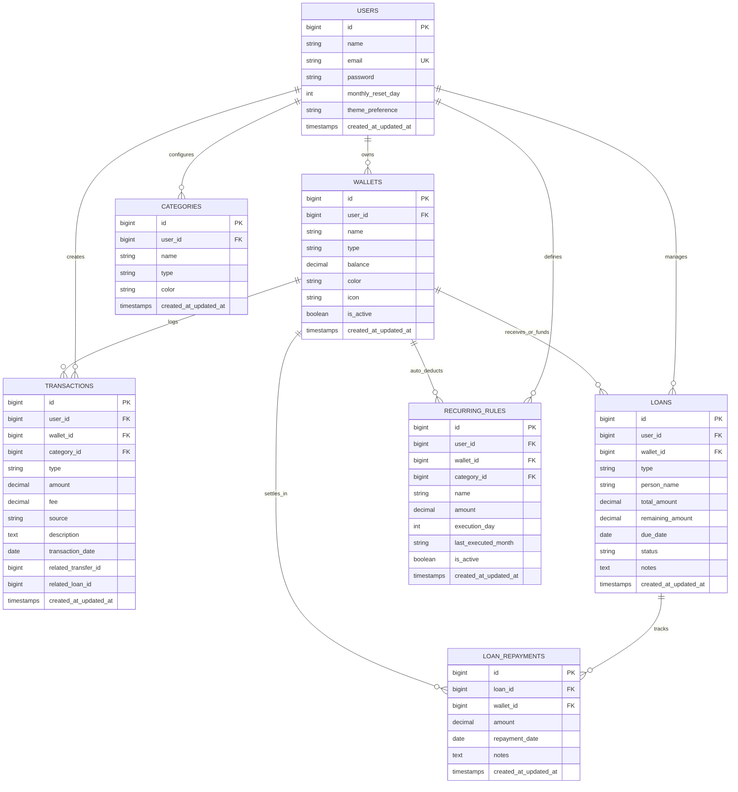

# Product Requirements Document (PRD) — Finora

**Nama Aplikasi**: Finora (Financial Organizer & Record Assistant)  
**Versi Dokumen**: 1.0.0  
**Status**: Approved & Siap Eksekusi  
**Tech Stack Utama**: Laravel 12, Blade Templates, Tailwind CSS v4, DaisyUI, Alpine.js, SQLite / MySQL  

---

## 1. Ringkasan Eksekutif & Latar Belakang

**Finora** adalah aplikasi manajemen keuangan pribadi yang dirancang dengan pendekatan *mobile-first*, sederhana, dan minimalis. Finora berfokus pada kemudahan pencatatan finansial sehari-hari tanpa kerumitan akuntansi konvensional. 

Pengguna modern umumnya memiliki uang yang tersebar di berbagai rekening bank, dompet digital (GoPay, OVO, ShopeePay), dan uang tunai fisik. Finora hadir untuk memberikan visibilitas penuh terhadap total kekayaan likuid, perpindahan saldo antar dompet (termasuk biaya admin/top-up), pencatatan hutang-piutang rekan, serta otomatisasi biaya langganan berulang bulanan.

---

## 2. Nilai Utama & Prinsip Produk

1. **Sederhana & Ringan**: Alur pencatatan cepat (kurang dari 5 detik untuk mencatat pengeluaran/pemasukan baru).
2. **Mobile First**: Dioptimalkan penuh untuk pengoperasian satu tangan pada layar ponsel pintar dengan navigasi bawah (bottom navigation) dan area sentuh minimal 44px.
3. **Multi-Wallet Fleksibel**: Bebas membuat, menamai, dan mengkategorikan dompet/rekening sesuai gaya hidup pengguna.
4. **Transparansi Transaksi Riil**: Mencatat biaya transfer/top up secara eksplisit agar saldo dompet selalu sinkron dengan kondisi di dunia nyata.
5. **Rollover Siklus Bulanan yang Rapi**: Riwayat keuangan masa lalu tetap tersimpan utuh untuk analisis historis, sementara ringkasan dashboard me-reset fokus ke bulan berjalan dengan sisa saldo bulan lalu sebagai saldo awal.

---

## 3. Persona Pengguna

- **Nama**: Rangga (27 tahun, Pekerja Lepas / Profesional Muda)
- **Karakteristik**: Memiliki 2 rekening bank (BCA, Mandiri), 3 e-wallet (GoPay, OVO, Dana), dan uang tunai. Memiliki pengeluaran langganan rutin (server VPS, cloud storage, Spotify) setiap awal bulan. Sering meminjamkan atau meminjam uang kecil ke teman/kolega dan membutuhkan pengingat pelunasan yang rapi.
- **Tantangan**: Sering lupa berapa sisa saldo di tiap e-wallet karena biaya admin top-up tersembunyi, serta sering bingung ke mana perginya uang di akhir bulan.

---

## 4. Ruang Lingkup Fitur (Features Scope)

### 4.1. Modul Autentikasi & Akun
- **Registrasi Akun**: Nama lengkap, email, password, dan konfirmasi password.
- **Login & Logout**: Autentikasi berbasis sesi aman Laravel dengan proteksi brute-force.
- **Pengaturan Profil**: Mengubah nama, kata sandi, dan preferensi akun (seperti hari cutoff bulanan).

### 4.2. Modul Multi-Wallet (Dompet Kustom)
- **Kustomisasi Penuh**: Pengguna dapat menambahkan dompet tanpa batas dengan jenis:
  - Rekening Bank (BCA, Mandiri, BRI, BNI, Jago, dll)
  - Dompet Digital / E-Money (GoPay, OVO, DANA, ShopeePay, dll)
  - Uang Tunai (Cash / Dompet Fisik)
  - Tabungan / Investasi Khusus
- **Pengaturan Saldo Langsung saat Tambah Wallet**:
  - Saat menambahkan e-wallet atau rekening bank baru, pengguna dapat langsung menginput nominal saldo awal pada dompet tersebut (misal Rp 1.500.000).
  - Nilai ini langsung diset sebagai saldo berjalan wallet dan dicatat sebagai transaksi mutasi awal (`initial_balance`).
- **Status Aktif dan Non-Aktif (Lifecycle & Visibilitas)**:
  - Setiap dompet memiliki kontrol status `is_active` (`Aktif` atau `Non-Aktif`).
  - **Dompet Non-Aktif**: Disembunyikan dari pilihan transaksi harian (pemasukan, pengeluaran, transfer, recurring) dan saldonya tidak dihitung ke dalam total saldo aktif di dashboard utama.
- **Mekanisme Reaktivasi & Penyesuaian Saldo Langsung**:
  - Jika dompet yang sebelumnya non-aktif diaktifkan kembali, sistem secara khusus menampilkan dialog/form reaktivasi yang mengizinkan pengguna untuk **langsung mengubah/memperbarui saldo** dompet tersebut.
  - Hal ini memfasilitasi kebutuhan pencocokan saldo riil tanpa perlu repot menghitung selisih manual setelah lama tidak digunakan.
  - Perubahan saldo saat reaktivasi dicatat sebagai transaksi penyesuaian saldo (`balance_adjustment`) agar riwayat audit tetap presisi.
- **Kalkulasi Saldo Real-Time**: Saldo wallet dikalkulasikan secara konsisten dari saldo awal, mutasi transaksi, transfer, hutang-piutang, serta penyesuaian saldo reaktivasi.

### 4.3. Modul Pemasukan (Add Balance / Income)
- **Input Data**:
  - Jumlah nominal uang masuk.
  - Wallet tujuan penerimaan dana.
  - Sumber uang (misalnya: Gaji Bulanan, Proyek Sampingan, Hadiah, Penjualan Barang, dll).
  - Kategori pemasukan opsional.
  - Catatan tambahan opsional.
  - Tanggal transaksi (default: hari dan jam saat ini).
- **Efek Finansial**: Menambah saldo wallet tujuan dan tercatat dalam mutasi pemasukan bulan berjalan.

### 4.4. Modul Pengeluaran (Expense)
- **Input Data**:
  - Jumlah nominal uang keluar.
  - Wallet sumber pemotongan.
  - Kategori pengeluaran (Makanan & Minuman, Transportasi, Tagihan, Belanja, Hiburan, dll).
  - Catatan / Keterangan.
  - Tanggal transaksi.
- **Efek Finansial**: Mengurangi saldo wallet sumber dan tercatat dalam mutasi pengeluaran bulan berjalan.

### 4.5. Modul Transfer Antar Wallet & Biaya Admin
- **Alur Mutasi Antar Dompet**:
  - Wallet Asal (contoh: Rekening BCA).
  - Wallet Tujuan (contoh: Saldo GoPay).
  - Nominal Transfer.
  - **Input Opsional Biaya Admin / Top-up**: Misal transfer Rp 100.000 dengan biaya admin Rp 1.000.
  - Opsi Pemotongan Biaya Admin: Dipotong langsung dari Wallet Asal (sehingga saldo asal berkurang Rp 101.000, wallet tujuan bertambah Rp 100.000).
  - Catatan transfer.
- **Efek Finansial**: Terbentuk 2 transaksi terkait (Transfer Out dan Transfer In) serta pencatatan biaya admin (Expense) yang terhubung.

### 4.6. Modul Pinjam & Piutang (Debt & Loan Management)
- **Dua Arah Pencatatan**:
  1. **Memberikan Pinjaman (Piutang / Loan Given)**:
     - Mengurangi saldo wallet yang dipilih.
     - Nama rekan yang meminjam.
     - Nominal pinjaman.
     - Tanggal jatuh tempo opsional.
     - Catatan / Keperluan.
     - Status: `Belum Lunas` / `Lunas Sebagian` / `Lunas`.
  2. **Menerima Pinjaman (Hutang / Debt Taken)**:
     - Menambah saldo wallet tujuan yang dipilih.
     - Nama pemberi pinjaman.
     - Nominal pinjaman.
     - Tanggal jatuh tempo opsional.
     - Status: `Belum Lunas` / `Lunas Sebagian` / `Lunas`.
- **Fitur Pelunasan / Cicilan (Repayment)**:
  - Form pencatatan cicilan/pelunasan bertahap.
  - Memilih wallet penampung pengembalian (untuk piutang) atau wallet pembayar (untuk hutang).
  - Sisa pokok pinjaman ter-update otomatis hingga lunas.

### 4.7. Modul Biaya Rutin / Langganan Otomatis (Recurring Rules)
- **Konfigurasi Langganan**:
  - Nama pengeluaran rutin (misal: "Sewa Server VPS DigitalOcean", "Spotify Family", "Biaya Admin Bulanan BCA").
  - Nominal tagihan.
  - Wallet sumber pemotongan.
  - Kategori pengeluaran.
  - Tanggal jatuh tempo per bulan (contoh: setiap tanggal 1).
  - Status aktif/non-aktif.
- **Mekanisme Eksekusi Hybrid**:
  - **On-Access Trigger (Utama)**: Setiap kali user membuka aplikasi atau mengakses dashboard pada/setelah tanggal jatuh tempo di bulan berjalan, sistem memeriksa apakah aturan berulang untuk bulan tersebut sudah dieksekusi. Jika belum, transaksi pengeluaran otomatis dibuat dan saldo wallet dipotong.
  - **Artisan Scheduler (Opsional)**: Disediakan command `php artisan finora:process-recurring` yang siap dijalankan via cron server jika aplikasi di-deploy di VPS/server produksi.

### 4.8. Sistem Siklus Bulanan & Reset Riwayat Keuangan
- **Tanggal Cutoff Fleksibel**: Standar sistem adalah tanggal 1 setiap bulannya, namun dapat diubah melalui menu Pengaturan (misalnya tanggal 25 bagi pengguna yang mengikuti siklus gajian).
- **Mekanisme Rollover (Tidak Menghapus Data)**:
  - Data historis masa lalu tetap tersimpan utuh di database dan dapat dilihat kembali dengan memilih filter bulan/tahun.
  - Pada tanggal 1 (atau tanggal cutoff pilihan), perhitungan ringkasan pengeluaran dan pemasukan di dashboard di-reset ke angka 0 untuk periode bulan baru.
  - Sisa saldo kumulatif dari seluruh wallet pada penutupan bulan lalu dihitung dan disajikan sebagai **Saldo Awal Bulan Ini (Opening Balance)**.

### 4.9. Halaman Dashboard Utama (Mobile-First)
- **Header Finora**: Avatar/Inisial pengguna, nama user, toggle mode gelap/terang, dan tombol notifikasi jatuh tempo.
- **Hero Card - Total Saldo Keseluruhan**:
  - Menampilkan total gabungan seluruh saldo wallet aktif.
  - Tombol sensor mata (toggle untuk menyembunyikan/menampilkan angka nominal demi privasi di tempat umum).
- **Widget Ringkasan Bulan Berjalan**:
  - Saldo Awal (Bawaan sisa bulan lalu).
  - Total Pemasukan bulan ini.
  - Total Pengeluaran bulan ini.
  - Arus Kas Bersih (Net Cashflow bulan berjalan).
- **Quick Actions (Aksi Cepat 1 Sentuhan)**:
  - Tambah Pemasukan
  - Catat Pengeluaran
  - Transfer Antar Dompet
  - Catat Pinjaman
- **Carousel / List Ringkas Dompet**:
  - Kartu ringkas tiap wallet yang menampilkan nama, badge jenis (Bank/E-Money/Cash), dan saldo terkini.
- **Daftar Transaksi Terbaru**:
  - Menampilkan 5 transaksi terakhir dengan format tanggal, ikon jenis, wallet terkait, dan nominal dengan warna penanda yang kontras.
- **Widget Pengingat Aktif**:
  - Alert ringkas jika ada tagihan langganan yang baru terpotong atau pinjaman yang mendekati jatuh tempo.

---

## 5. Struktur Basis Data (Entity Relationship)



---

## 6. Logika Bisnis Kunci (Key Business Logic)

### 6.1. Perhitungan Periode dan Rollover Bulanan
```
Periode Mulai = [Tahun saat ini]-[Bulan saat ini]-[Reset Day]
Periode Akhir = 1 hari sebelum [Periode Mulai Bulan Depan]

Saldo Awal (Opening Balance) Bulan Berjalan:
= Total Saldo Seluruh Wallet pada detik sebelum Periode Mulai berjalan.

Total Pemasukan Bulan Berjalan:
= SUM(amount) dari TRANSACTIONS dengan type IN ('income') dalam rentang Periode Mulai s.d. Periode Akhir.

Total Pengeluaran Bulan Berjalan:
= SUM(amount + fee) dari TRANSACTIONS dengan type IN ('expense', 'recurring_expense') dalam rentang Periode.

Total Saldo Nyata:
= SUM(balance) dari seluruh WALLETS aktif milik user.
```

### 6.2. Eksekusi Transfer & Biaya Admin
Ketika user mentransfer Rp 50.000 dari Bank A ke E-Money B dengan biaya admin Rp 1.500:
1. Validasi saldo Bank A >= (Rp 50.000 + Rp 1.500).
2. Potong saldo Bank A sebesar Rp 51.500.
3. Tambah saldo E-Money B sebesar Rp 50.000.
4. Buat record transaksi `transfer_out` pada Bank A dengan `amount = 50000` dan `fee = 1500`.
5. Buat record transaksi `transfer_in` pada E-Money B dengan `amount = 50000` dan `fee = 0`.
6. Hubungkan kedua transaksi via `related_transfer_id`.

### 6.3. Eksekusi Hybrid Recurring Subscription
Saat request ke dashboard diterima:
1. Ambil seluruh data `RECURRING_RULES` milik user dengan `is_active = true`.
2. Untuk setiap rule:
   - Hitung tag bulan saat ini, misal `2026-10`.
   - Cek apakah tanggal hari ini >= `rule.execution_day`.
   - Cek apakah `rule.last_executed_month != '2026-10'`.
   - Jika kondisi terpenuhi:
     - Kurangi saldo `wallet_id` terkait sebesar `amount`.
     - Catat record baru di tabel `TRANSACTIONS` dengan type `recurring_expense`.
     - Update `rule.last_executed_month = '2026-10'`.

### 6.4. Inisialisasi Saldo saat Tambah Wallet
Ketika pengguna menambahkan wallet baru (misal: Bank BCA dengan saldo awal Rp 2.500.000):
1. Buat record baru di tabel `WALLETS` dengan `balance = 2500000` dan `is_active = true`.
2. Jika saldo awal > 0:
   - Catat transaksi awal di tabel `TRANSACTIONS` dengan `type = 'initial_balance'`, `amount = 2500000`, `description = 'Saldo Awal Dompet'`.

### 6.5. Logika Reaktivasi & Penyesuaian Saldo Dompet
Ketika pengguna mengaktifkan kembali dompet yang sebelumnya berstatus `is_active = false`:
1. Sistem menampilkan modal reaktivasi yang menampilkan saldo lama (misal Rp 150.000) dan input "Saldo Baru Terkini".
2. Pengguna dapat memilih untuk mempertahankan saldo lama ATAU memasukkan saldo baru (misal Rp 750.000).
3. Jika pengguna memasukkan saldo baru:
   - Hitung selisih: `selisih = saldo_baru - saldo_lama`.
   - Update `WALLETS.balance = saldo_baru` dan `WALLETS.is_active = true`.
   - Catat mutasi penyesuaian di tabel `TRANSACTIONS` dengan:
     - `type = 'balance_adjustment'`
     - `amount = ABS(selisih)`
     - `description = 'Penyesuaian Saldo saat Reaktivasi Dompet'`
4. Jika saldo tidak diubah:
   - Cukup update `WALLETS.is_active = true`.

---

## 7. Rute & Navigasi Aplikasi

| Rute URL | Method | Keterangan Halaman |
|---|---|---|
| `/login` | GET, POST | Autentikasi masuk pengguna |
| `/register` | GET, POST | Pendaftaran akun baru |
| `/logout` | POST | Keluar dari sesi |
| `/dashboard` | GET | Halaman utama: Ringkasan saldo, statistik bulanan, quick actions, transaksi terakhir |
| `/wallets` | GET, POST | Manajemen daftar dompet, tambah dompet baru beserta saldo awal |
| `/wallets/{id}` | PUT, DELETE | Edit nama/tipe dompet atau hapus dompet |
| `/wallets/{id}/toggle-status` | POST | Ubah status aktif/non-aktif dompet |
| `/wallets/{id}/reactivate` | POST | Reaktivasi dompet non-aktif beserta opsi update saldo langsung |
| `/transactions` | GET, POST | Riwayat lengkap transaksi dengan filter bulan/kategori/wallet, form input transaksi baru |
| `/transactions/transfer` | POST | Endpoint pemrosesan transfer antar wallet |
| `/loans` | GET, POST | Manajemen hutang dan piutang |
| `/loans/{id}/repay` | POST | Input pelunasan / cicilan pinjaman |
| `/recurring` | GET, POST, DELETE | Pengaturan biaya langganan dan admin bank otomatis |
| `/settings` | GET, POST | Konfigurasi tanggal cutoff bulanan, preferensi profil, dan tema |

---

## 8. Standar Non-Fungsional & Aksesibilitas
1. **WCAG 2.1 AA Compliance**: Seluruh teks memiliki rasio kontras minimal 4.5:1 terhadap warna latar belakang.
2. **Performa Tanggap**: Waktu muat halaman pertama di perangkat seluler < 800ms.
3. **Resilience**: Setiap komponen data memiliki 3 state wajib:
   - *Empty State*: Tampilan ramah dan ilustratif jika data transaksi/dompet masih kosong.
   - *Loading State*: Indikator pemrosesan saat submit form.
   - *Error State*: Validasi input dengan pesan berbahasa Indonesia yang jelas.
4. **Keamanan**: Seluruh query database terisolasi ketat menggunakan scoped user id `Auth::id()`. Proteksi CSRF aktif di seluruh formulir.
